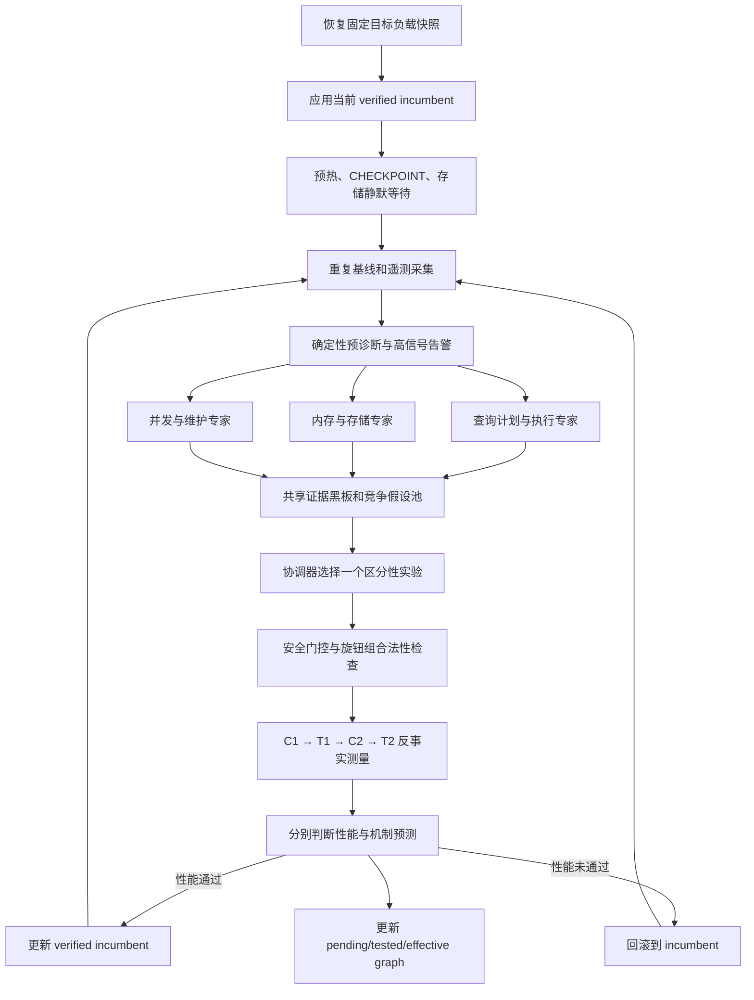

# Andromeda 基于诊断的多智能体数据库调优阶段报告（10/14）

> 日期：2026-10-14  
> 标签：`10/14`  
> 当前目标：在 TPC-C → Twitter 负载切换后，以 TPS 为唯一优化目标，用可验证的诊断链选择 PostgreSQL 旋钮组，并与 60 维基础贝叶斯优化公平比较。

## 1. 当前结论

Andromeda 已经实现了可以实际执行的多智能体诊断调优闭环：恢复固定快照、建立重复基线、并行提出竞争假设、通过共享证据图协作、串行执行旋钮组干预、做 control/treatment 反事实复测、接受或回滚配置，并保存完整中间结果。贝叶斯优化参考流程也已经能够在同一 60 维旋钮空间运行。

但是，已有实验还不能证明诊断方法优于贝叶斯优化。旧实验中，Andromeda 的最好保留值为 **2962.029 TPS**，基础贝叶斯优化前 11 个候选已达到 **3236.695 TPS**，100 轮最高观测为 **3500.688 TPS**。更关键的是，Andromeda 接受的两个候选中，一个机制结论为 `refuted`，另一个为 `inconclusive`，没有形成一条从干预到 TPS 的完整受支持因果链。因此目前可以确认的是工程闭环可运行，尚不能确认诊断准确性和调优效率优于黑盒搜索。

目前最重要的发现是：**旧诊断使用的证据粒度与真实瓶颈不一致。** Twitter 负载中，约 1% 的 `InsertTweet` 写事务可以因为 COMMIT/WAL 长尾占满全部 terminal 时间；与此同时，90% 左右的快速读事务会让总体 p95、缓存命中率、锁等待等聚合指标保持“正常”。所以“中间指标看起来正常”和“TPS 很低”并不矛盾。TPS 本身没有失效，缺失的是能把 TPS 下降定位到具体事务、SQL、等待事件和执行路径的证据。

10/14 的新服务器实验又暴露了实验负载配置问题：Twitter 在 scale factor 100、16 terminals、`TRANSACTION_SERIALIZABLE` 下出现 PostgreSQL `SQLSTATE 53200: out of shared memory`。这不是一个可用于训练或比较的低 TPS 样本，而是资源约束下的无效测量。当前代码已将 Twitter 默认并发降到 **8 terminals**，保持 unlimited rate，并扩大、保护 SERIALIZABLE 所需的谓词锁和普通锁空间；是否彻底消除 53200 仍需在华为 SCOW 环境重新跑正式基线确认。

## 2. 我们现在的方法如何工作

当前实现采用“共享证据黑板 + 竞争假设 + 单实验串行验证”的协作方式。多智能体不是互相投票，也不是每个智能体各自修改数据库。专家并行阅读同一份 incumbent 快照，输出结构化假设；协调器把这些假设和补充证据放入同一证据图，每轮只选择一个最有区分力且可安全执行的实验。

### 2.1 三个诊断专家

1. **查询计划与执行专家**：检查代表性 SQL、执行计划、顺序扫描/索引扫描、估算偏差、统计信息和 planner/executor 旋钮。
2. **内存与存储专家**：检查缓存、临时文件、事务提交延迟、WAL write/sync、主机 I/O pressure、后台写入和 checkpoint。
3. **并发与维护专家**：检查锁等待、冲突、连接并发、autovacuum 和 autoanalyze。

每个专家必须提交结构化局部假设、证据 ID、候选旋钮组、替代解释和预先冻结的方向性预测。一个诊断机制如果天然涉及多个旋钮，专家可以提出一个最小的、机制一致的旋钮组；系统不再强迫所有问题只能改一个旋钮。数据库参数和负载测量始终串行执行，避免多个智能体同时干预造成不可归因结果。

### 2.2 证据图如何协作

证据图分为三层：

- `pending_graph.json` 保存尚未验证的假设、预测和候选边；
- `tested_graph.json` 保存已经执行过实验、但可能被支持、反驳或仍不确定的边；
- `effective_graph.json` 只保存从参数干预经过机制指标最终连到 TPS、且整条路径均被实验支持的边。

专家之间的交叉审查用于补充指标、提出竞争解释、指出副作用或注册真正的交互实验。它不做多数投票。协调器根据可执行性、区分竞争解释的信息量、测量成本和重启成本选择实验。若没有足够证据支持干预，允许输出 `observation-only`，防止大模型为了“必须改参数”而随机试旋钮。

### 2.3 一轮调优的实际执行

每轮从当前 verified incumbent 出发：

1. 恢复同一个目标负载数据库快照，避免数据状态随实验轮次漂移。
2. 应用 incumbent，预热后执行 checkpoint，并等待快照恢复产生的后台 I/O 尽量稳定。
3. 收集 TPS、总体延迟、分事务延迟、terminal 容量占比、PostgreSQL 统计、WAL timing、等待事件类别、Linux PSI 和 dirty/writeback 等证据。
4. 三个专家基于同一快照并行提出竞争假设，协调器只选一个实验。
5. 对选中的旋钮组进行范围、依赖、资源和回滚检查。
6. 按 `control_1 → treatment_1 → control_2 → treatment_2` 运行反事实验证。
7. 性能结论与机制结论分开记录。TPS 改善可以更新 incumbent，但若中间机制预测不成立，因果边仍记为 `refuted` 或 `inconclusive`，并标记 `unexplained_performance=true`。
8. 未通过的候选回滚；通过的配置成为下一轮 incumbent。结束时恢复实验开始前的 PostgreSQL 配置。

### 2.4 与贝叶斯优化的关系

基础贝叶斯优化是独立对照方法，在 60 个可调 PostgreSQL 旋钮上以 TPS 为唯一目标搜索。BO 的候选、最佳 TPS 和目标参考配置对在线诊断智能体保持隐藏，避免把答案泄露给诊断过程。BO 无效配置不进入 GP 训练，SERIALIZABLE 下的资源耗尽会被记录为失败并按资源安全规则处理。

公平比较必须使用相同的源配置、目标快照、硬件、旋钮边界、随机种子、负载时长、并发和最终独立复测协议。还必须同时报告工作负载测量次数和墙钟时间，因为 Andromeda 一个候选通常消耗四次测量，而 BO 一个候选通常只测一次。

## 3. 到目前为止已经实现和验证的能力

### 3.1 已实现

- PostgreSQL、BenchBase、Python、数据库角色、三个负载数据库和快照的一键部署流程。
- TPC-C、Twitter、YCSB 的快照恢复与 BenchBase 运行接口。
- 60 维 PostgreSQL 可调空间和独立基础贝叶斯优化。
- TPC-C → Twitter 与 Twitter → TPC-C 的负载切换实验框架。
- 三专家并行提案、共享证据黑板、竞争假设、透明协调和串行执行。
- 机制一致的旋钮组干预、四段 control/treatment 复测、接受/回滚和最终恢复。
- 重复基线、历史同上下文基线注册、漂移与异常低基线检查。
- 分事务类型的 count、mean、p50、p95、p99、max 和 terminal 容量占比。
- WAL I/O timing、按类型等待事件、Linux PSI I/O、dirty/writeback 和快照恢复后的静默等待。
- 完整实验台账、逐轮性能 CSV、模型输入输出、图版本、可读报告和最终回滚记录。
- 对旧 Twitter 结果进行离线回放：9 次历史测量均可识别 `InsertTweet` 为关键事务，说明新增事务级证据能捕捉旧聚合指标遗漏的问题。

### 3.2 尚未完整实现

以下内容来自 10/14 提出的“查询级证据驱动”方案，当前不能写成已经完成：

- 按测量窗口重置并读取 `pg_stat_statements`，按 `total_exec_time` 输出 Top-N 查询模板。
- 通过 `query_id/queryid` 把 `pg_stat_activity` 等待采样归因到具体查询模板。
- 为 Top-N 查询持续生成实际行数、估算行数、buffers 和 temp spill 的执行计划摘要。
- 将当前合并的“内存与存储专家”拆成 Memory 与 IO 两个专家，形成 Memory、IO、Concurrency、Query 四专家结构。
- 显式的分层假设栈、查询分支/参数分支路由，以及“缺索引或 SQL 结构问题，参数调优无效”的正式终止结论。
- 从历史轨迹自动学习机制—旋钮映射、断点模式和条件化调优模板的离线学习智能体。

当前已有 query execution 专家和一个不会真正执行 SQL 的代表性 `EXPLAIN (FORMAT JSON)` 采集器，但这还不是完整的查询级证据闭环：它不能证明最耗时的真实 SQL 是哪一条，也不能把等待事件稳定绑定到该 SQL。

## 4. 已有实验结果说明了什么

旧版 30 秒、2 terminals 的 Twitter 对比中：

| 对比口径 | Andromeda | 基础 BO | 结果 |
|---|---:|---:|---|
| 前 11 个候选最好 TPS | 2962.029 | 3236.695 | BO 高 9.27% |
| 相近墙钟时间最好 TPS | 2962.029 | 3491.130 | BO 高 17.86% |
| 全部预算最好观测 TPS | 2962.029 | 3500.688 | BO 高 18.19% |
| 受支持的完整因果链 | 0 | 不做因果诊断 | Andromeda 尚未证明诊断有效 |

Andromeda 共执行 57 次负载测量、20 次 PostgreSQL 重启，约耗时 4924 秒；基础 BO 100 轮约耗时 6913 秒。Andromeda 的 11 个候选中只有 2 个被性能规则接受，接受的旋钮变化是：

- `autovacuum_analyze_scale_factor: 0.1 → 0.02`
- `autovacuum_naptime: 60 → 20`
- `default_statistics_target: 100 → 500`

但这两个 accepted 候选的机制没有得到支持，所以不能把 TPS 变化解释为诊断准确。旧 Andromeda 初始 TPS 曾低至 362.933，而同语义源配置的 BO 基线为 2852.495；由异常低起点计算出的 716.14% 改善不可信，也促使我们后来加入重复基线和历史基线漂移门控。

上述数值来自旧的低并发协议，只能用于解释方法为何需要修改，不能直接代表 10/14 新协议下的性能。新协议为：

| 负载 | 隔离级别 | Scale factor | Terminals | 正式时长 | Warmup | Rate |
|---|---|---:|---:|---:|---:|---|
| TPC-C | `TRANSACTION_SERIALIZABLE` | 20 | 10 | 120 秒 | 30 秒 | unlimited |
| Twitter | `TRANSACTION_SERIALIZABLE` | 100 | 8 | 120 秒 | 30 秒 | unlimited |

Twitter 曾尝试 16 terminals，但在当前服务器资源和 SERIALIZABLE 条件下触发大量 `SQLSTATE 53200`。因此 8 terminals 是当前用于重新建立有效基线的工程选择，不代表它已是最终最佳并发。后续应通过 4/8/12 terminals 的独立容量扫描确认饱和点，再冻结正式比较并发。

## 5. 我们最开始遇到的困难

### 5.1 第一轮根本没有启动

早期单智能体链在初始基线之后直接进入 `blocked`，已完成干预为 0，错误是 `DeepSeek returned an invalid or non-executable diagnosis`。根因是模型输出没有满足严格结构或没有形成可执行的证据—机制—旋钮链。后来增加了结构化 schema、最多三次修复重试、动作合法性检查和 observation-only 表达，但这个经历说明大模型输出必须经过确定性验证，不能直接执行。

### 5.2 部署环境和数据快照不完整

在新服务器上曾连续遇到 `.venv` 不存在、BenchBase 不在预期目录、PostgreSQL 未启动、数据库角色密码不匹配、`twitter.dump` 缺失或为零字节等问题。程序因此在实验开始前退出。这些问题推动了一键部署脚本加入角色创建/密码修复、TCP 连接验证、BenchBase 固定版本、数据库装载、快照非空校验和 `pg_restore --list` 校验。

### 5.3 很多指标正常，但效果仍然很差

这是最关键的方法问题。一次失败轨迹中，TPS 从约 3193 降到 523、411、262，而总体 p95 仍只有约 0.4–0.5 ms。与此同时：

- buffer hit rate 超过 99.98%；
- 没有明显 temp spill；
- `locks_waiting=0`，没有显著 deadlock/conflict；
- 没有明显 checkpoint 活动；
- 读事务仍只有约 250–300 微秒。

旧诊断据此判断内存、锁和计划路径都没有活跃瓶颈，大多数专家只能返回 observation-only。后来检查分事务原始数据才发现，`InsertTweet` 中位延迟从 15–19 ms 上升到 323–566 ms，并在一次 30 秒、2 terminal 的测量中占用 55–57 个 terminal-seconds。PostgreSQL 日志还有大量 300–1800 ms 的 `COMMIT`。真正路径是低占比写事务的提交/WAL 长尾耗尽 terminal，而总体 p95 被大量快速读事务掩盖。

### 5.4 旋钮诊断没有命中真实机制

早期方法曾把主要注意力放在 `random_page_cost`、`seq_page_cost` 和 `effective_cache_size` 上，但 Twitter 的关键查询已经使用 Index Scan，改变页面成本只改变估算成本，并不能解决慢 COMMIT。实际干预还越过了 BO 最优附近的值。说明“BO 最佳配置中某个旋钮不同”只能证明存在联合配置差异，不能证明该旋钮是当前故障的原因。

### 5.5 旋钮组被错误拆分或拒绝

旧协调器把 `effective_cache_size` 归到内存，把 `random_page_cost` 和 `seq_page_cost` 归到查询机制，导致同一个规划代价模型的三旋钮组被判断为跨域动作而拒绝。现在这三个旋钮已统一归入 query family，并允许专家针对一个机制提出最小一致旋钮组。真正跨独立机制的组合仍需要预注册交互实验，避免多个变化无法归因。

### 5.6 基线漂移和瞬时后台事件污染因果判断

同配置 control 曾从 411 TPS 漂到 262 TPS，快照恢复时间也从约 0.8–2.0 秒逐步增至 5.7–9.7 秒。若 treatment 恰好落在较好的时间段，就可能被错误接受；若落在较差的时间段，也可能把有效配置拒绝。后来增加了重复基线、同上下文历史基线、C1/T1/C2/T2 交错测量、checkpoint 和存储静默等待，但共享存储与宿主机抖动仍是正式实验必须报告的限制。

### 5.7 提高并发后触发资源失败

为避免 2 terminals 压力过低，正式设置提高到 TPC-C 10 terminals、Twitter 最初 16 terminals。Twitter scale 100、SERIALIZABLE 会维护大量谓词锁，最终出现 `SQLSTATE 53200: out of shared memory`。这类运行应标记为无效，而不能当成低 TPS 训练 GP。代码已加入锁容量安全范围、基线资源重试、无效候选惩罚与 Twitter 8 terminals 默认值。还需要在目标服务器确认内存、`max_pred_locks_per_transaction`、`max_locks_per_transaction` 和并发的组合边界。

### 5.8 “观察”太多并不是单一策略错误

多数 observation-only 一部分来自合理门控：当缓存、锁、临时文件和计划都没有指向可控路径时，系统拒绝盲调是正确行为。问题在于证据池缺少决定吞吐量的维度，使专家永远拿不到足够证据。简单放宽门控只会把诊断法退化成随机搜索；正确方向是增加事务级和查询级证据，再让区分性实验验证因果关系。

## 6. 10/14 后的方法修改方向

下一阶段把调优过程从“实例级指标驱动”推进为“查询级证据驱动的分层假设检验”。核心问题固定为三句：**哪条 SQL 慢了？它在等什么？它是怎么执行的？**

### 6.1 P0：建立查询级证据采集层

1. 启用 `pg_stat_statements`，每个独立测量窗口开始前重置统计，结束后按 `total_exec_time` 选 Top-N 查询模板。记录 calls、total/mean/max/stddev、rows、shared/local/temp blocks 和 WAL 相关字段。
2. 高频采样 `pg_stat_activity`，记录 `query_id/queryid`、`wait_event_type`、`wait_event` 和持续时间，把 Lock、LWLock、IO、Client、CPU 状态归因到具体查询模板。
3. 为 Top-N 查询生成安全的计划摘要。只读查询可在隔离的副本或可回滚事务中使用受控 `EXPLAIN ANALYZE`；写查询不能在正式库上直接重放，应优先使用 `auto_explain` 采样或无执行的 `EXPLAIN`，防止诊断采集改变数据。
4. 将三类信息封装为统一记录：查询模板、总耗时占比、等待分布、计划节点、估算偏差、buffer/temp/WAL 使用和来源时间窗。

### 6.2 P1：增加确定性预诊断与分流

在调用大模型之前先计算：

- 每类事务的 terminal 容量占比和延迟变化；
- Top-N SQL 对总执行时间的覆盖率；
- 单位成功事务的 blocks、WAL bytes、WAL sync time 和锁等待；
- incumbent 与当前窗口的同配置漂移；
- 快照恢复后的 I/O 是否达到静默条件。

如果每事务数据库工作量近似不变，但某类事务延迟激增，应优先进入查询/提交路径；如果单位事务工作量显著改变，再进入参数分支；如果证据显示缺索引、SQL 结构或客户端限速，应明确输出“PostgreSQL 参数调优不是主路径”，而不是继续试参数。

### 6.3 P2：改成四专家和分层竞争假设

将领域拆成 Memory、IO、Concurrency、Query 四个专家。每个专家绑定自己的锚定指标，但都能引用共享查询记录。诊断引擎维护有父子关系的假设栈，按覆盖度、区分信息量、实验成本和预期收益排序。若两个假设都能解释现象，优先执行能产生不同预测的实验，而不是选择“听起来最像”的解释。

### 6.4 P3：把机制验证与性能调优分成两个阶段

小扰动首先用于回答因果问题，不要求立即提高 TPS。例如，若假设是 WAL sync 长尾，就冻结对 `wal_sync_time/transaction`、`InsertTweet p99` 和 TPS 的方向性预测，再做可回滚扰动。只有机制边得到支持后，调优专家才沿该因果链设计更大范围的旋钮组，并在安全边界内寻找高 TPS。这样可以避免一次大幅联合修改虽然提高 TPS，却无法说明为何有效。

### 6.5 P4：形成离线学习闭环

从完整轨迹中提取成功案例、被反驳假设、机制—旋钮规则、有效范围和断点模式。离线规则只能作为新假设的先验，不能替代当前环境的证据和反事实验证。BO 最优配置也只能在实验结束后用于对照和消融，不能在在线诊断阶段泄露。

## 7. 下一轮实验计划

### 7.1 先冻结负载容量

在相同 Twitter 快照和安全数据库配置下分别测试 4、8、12 terminals，每档至少重复 3 次，记录 TPS、错误率、SQLSTATE、CPU、I/O、每事务延迟和谓词锁资源。选择能够产生压力、TPS 不被客户端上限截断、又不会触发 53200 的最低稳定饱和档。当前 8 terminals 只是候选默认值。

### 7.2 重新建立两个工作负载的 BO 参考

使用正式 TPC-C 与 Twitter 配置，各运行 100 轮 BO；无效资源配置记为失败，不进入 GP。对 BO 最优若干候选使用与诊断方法相同的独立重复协议复测，保存稳定中位数和保守值，避免使用单次最高 TPS。

### 7.3 做查询证据的增量消融

至少比较三组：

1. 当前三专家实例级/事务级证据版本；
2. 加入 `pg_stat_statements + query wait attribution + plan summary` 的版本；
3. 60 维基础 BO。

三组使用同一源配置、快照、硬件、并发、120 秒测量、30 秒 warmup 和最终复测。报告 best-so-far TPS、达到 BO 稳定最佳值 90%/95% 所需的测量数与墙钟时间、完整受支持因果链数量、错误诊断率、observation-only 比例、无效运行数、模型调用和 token 成本。

### 7.4 成功标准

下一阶段不能只以“TPS 上升过”作为成功。至少满足：

- 正确定位占总耗时主要比例的事务和 SQL；
- 等待事件或执行计划证据与根因一致；
- 旋钮组扰动使预注册的机制指标按预测方向变化；
- TPS 改善在独立重复测量中稳定存在；
- 从干预到机制再到 TPS 至少形成一条完整 supported path；
- 在相同测量预算或墙钟预算下，达到接近 BO 参考的稳定 TPS；
- 如果根因是索引、SQL、客户端或宿主机 I/O，系统能够停止无效参数调优并给出明确证据。

## 8. 报告与原始证据位置

- 多智能体方法说明：`docs/multi_agent_diagnosis.md`
- 事务关键路径修订：`docs/diagnosis_method_revision.md`
- BO 与负载切换流程：`docs/bo_reference_switch_workflow.md`
- 旧失败的逐项分析：`artifacts/workload_switch/bo-switch-formal/episodes/repeat_01/tpcc_to_twitter/FAILURE_ANALYSIS.md`
- 旧 Andromeda 与 BO 完整对比：`artifacts/bayesian/bo-twitter-20261009T033659Z/twitter/ANDROMEDA_VS_BAYESIAN_REPORT.md`
- 每次新实验的主要文件：`performance.csv`、`experiment_ledger.jsonl`、`hypothesis_pool.jsonl`、`round_NNN_decision.json`、`pending_graph.json`、`tested_graph.json`、`effective_graph.json`、`REPORT.md` 和 `report.json`。

## 9. 阶段判断

截至 10/14，Andromeda 已从“大模型直接推荐参数”推进到可审计的多智能体竞争假设和反事实验证系统，也补上了分事务关键路径、WAL/等待/I/O 和实验稳定性证据。但目前的证据仍不足以证明方法优于 BO，最主要的缺口是没有把最耗时的真实 SQL、它的等待事件和它的执行计划绑定到同一个测量窗口。

下一步不应扩大盲目搜索范围，而应先完成查询级证据闭环。只有当系统能够从“TPS 下降”追踪到“哪类事务占满 terminal”以及“哪条 SQL 在何种等待或计划节点上耗时”，再用旋钮组扰动验证这条路径，诊断调优的优势才可能被正式实验验证。
